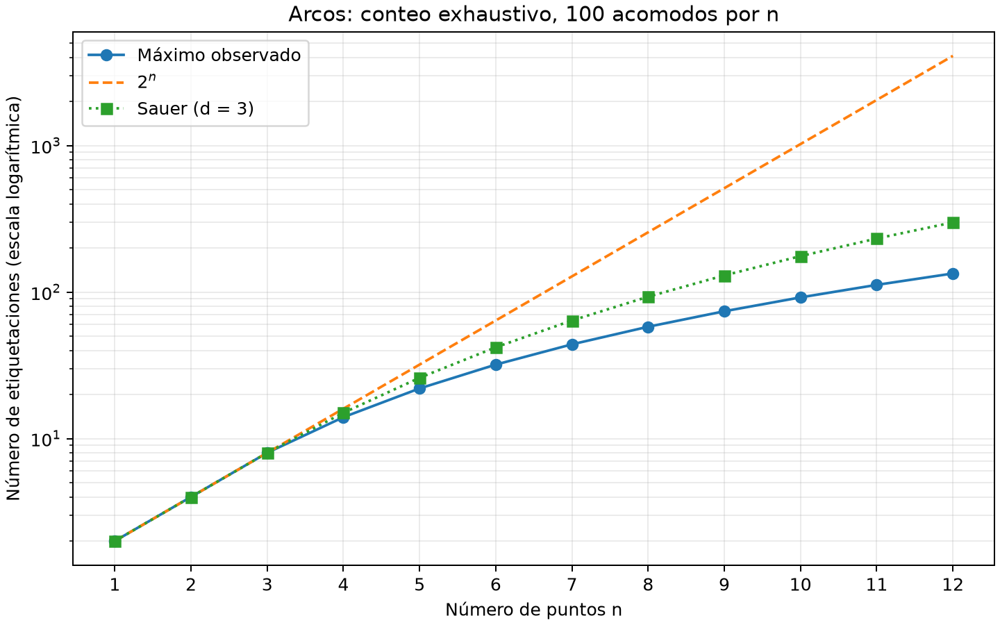
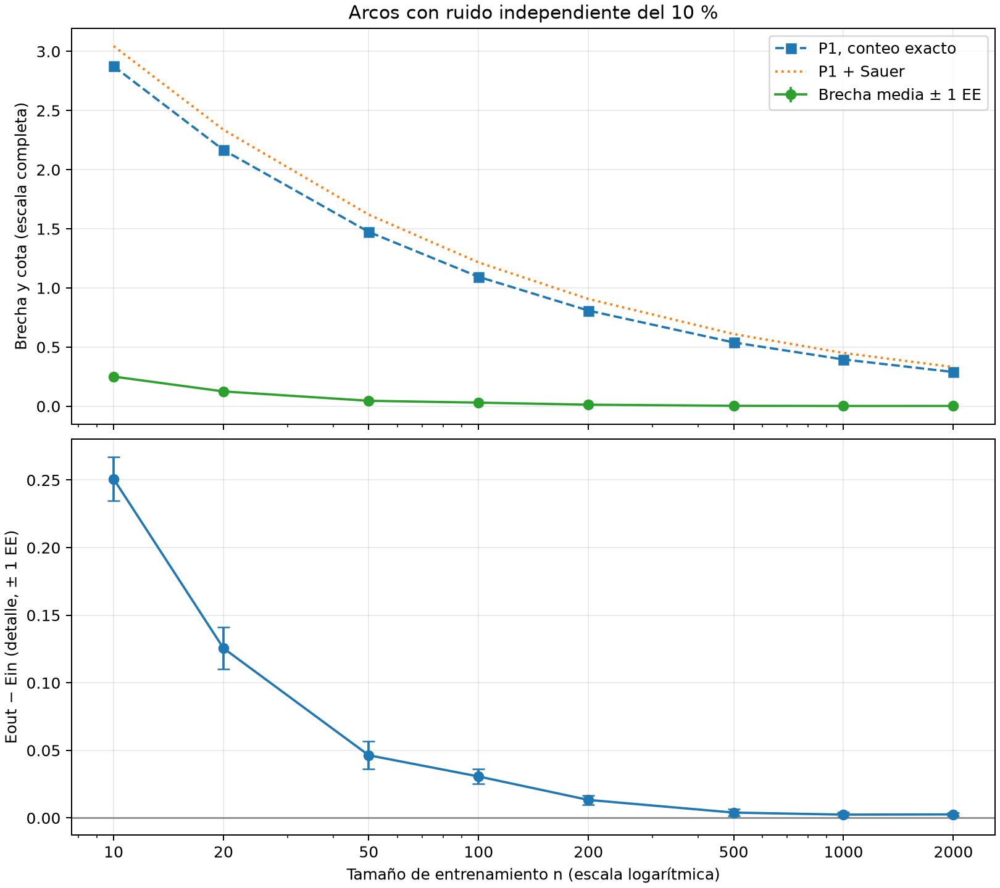
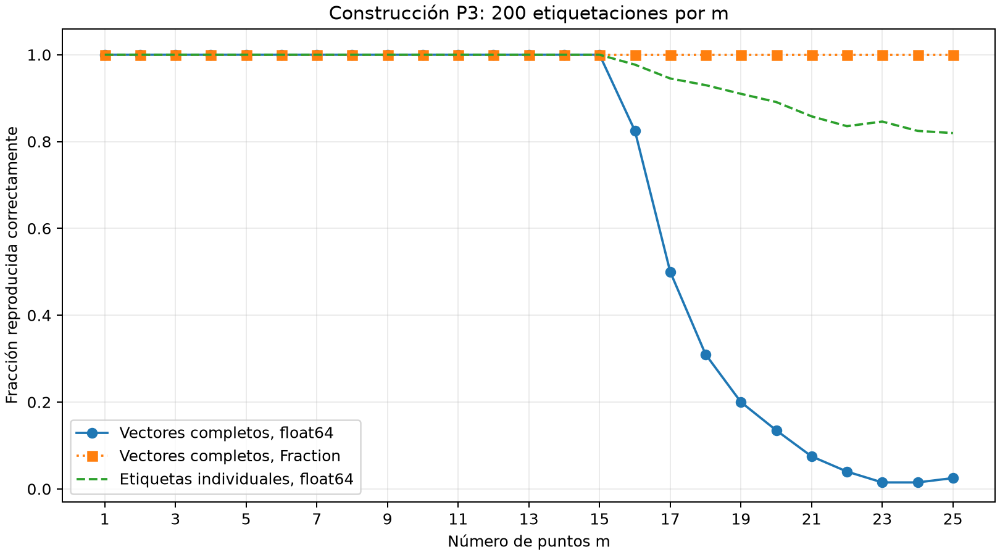
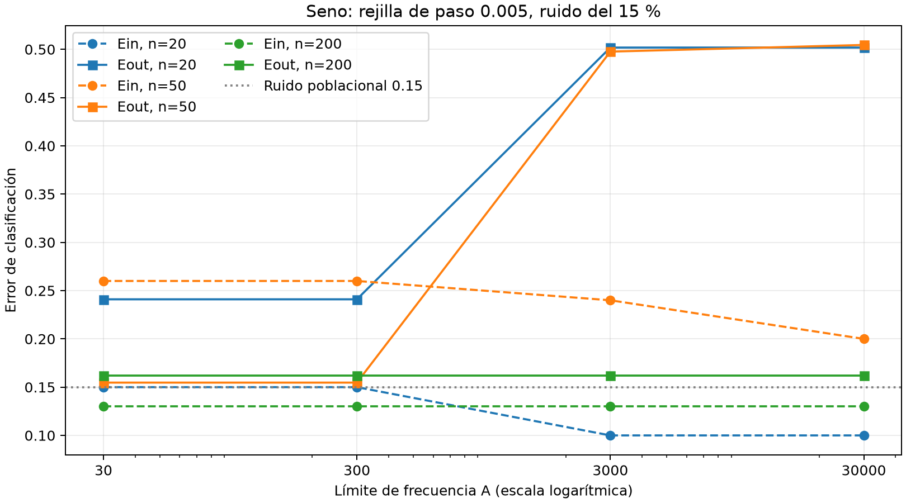

# Problema 1: Arcos de la circunferencia unitaria

Parte práctica (a)–(d) implementada y ejecutada.
Semilla: 221201513.

## Código

- `src/arcos.py`: Arcos cerrados, predicción, realizabilidad y ERM exacto.
- `src/conteo.py`: Enumeración exhaustiva de etiquetas y comparación con Sauer.
- `src/aprendizaje.py`: Curva de aprendizaje y comparación con la cota.
- `src/seno.py`: Entrada para precisión float64 frente a Fraction y búsqueda en rejillas.
- `src/rejillas.py`: Búsqueda por bloques y evaluación de frecuencias, con sensibilidad al paso.
- `src/cota.py`: cálculo reproducible del tamaño de muestra de teoría (c), implementado.

## Ejecución

Trabajar desde la raíz con el entorno común de `pyproject.toml`.
Preparar las dependencias con `uv sync --locked`. Las gráficas usan Matplotlib
y la búsqueda de rejillas usa NumPy, ambos declarados en `pyproject.toml`.

Para ejecutar todo el problema, incluidos los presupuestos completos y la
sensibilidad de las rejillas, basta este comando desde la raíz:

```sh
uv run --locked python ejecutar.py problema-1
```

`uv run --locked` crea el entorno si hace falta. La entrada común usa el mismo
intérprete, ejecuta los cinco pasos en orden, muestra el avance y se detiene ante
un error. Los comandos por inciso se conservan a continuación para ejecución
individual; no hace falta copiarlos todos para reproducir el problema completo.

### Conteo de arcos: práctica (a)

La gráfica usa Matplotlib con el motor Agg, sin ventanas ni ejecutables gráficos
externos. La biblioteca está declarada en `pyproject.toml` y sus versiones y
dependencias transitivas están fijadas en `uv.lock`. Preparar el entorno:

```sh
uv sync --locked
```

Las pruebas usan `unittest`, incluido en Python; no requieren otra biblioteca.

Experimento completo exigido (n=1..12, 100 acomodos por n):

```sh
uv run --locked python problema-1/src/conteo.py
```

Prueba rápida, que no sustituye el experimento completo:

```sh
uv run --locked python problema-1/src/conteo.py --n-max 4 --acomodos 3 --salida /tmp/rp-conteo-rapido
```

Verificación de la realizabilidad contra arcos construidos geométricamente,
incluyendo todas las etiquetas para n=1..7 y casos de puntos repetidos:

```sh
uv run --locked --directory problema-1 python -m unittest discover -s tests -v
```

Los puntos se representan por ángulos canónicos en radianes, en `[0, 2*pi)`.
Para recuperar coordenadas de la circunferencia se usa `(cos(theta), sin(theta))`.
Se permiten arcos cerrados que cruzan cero, vacío y completo. Los puntos
exactamente repetidos deben compartir etiqueta; los cercanos no se fusionan
mediante tolerancias. La entrada excluye `2*pi`, cuya representación canónica
es cero. La función rechaza ángulos fuera de rango y etiquetas distintas de ±1.

`realizable` ordena los puntos, agrupa los repetidos y cuenta los cambios de
signo en el recorrido circular, incluyendo el cierre del último al primero.
Cero cambios corresponde a etiquetas constantes; dos, a un bloque positivo;
más de dos exige varios bloques y no se realiza con un arco. Costo por llamada:
O(n log n), memoria O(n). Es exacto para los puntos representados, sin rejillas
ni aproximaciones en la decisión de realizabilidad.

Se muestrean ángulos uniformes con la biblioteca estándar `random`, rechazando
repeticiones exactas dentro de cada muestra. Para cada pareja `(n, acomodo)` se
crea `random.Random(f"221201513:p1:conteo:{n}:{acomodo}")`, con índices de
acomodo desde cero. Son subflujos derivados de la semilla raíz 221201513;
no se usa `hash()` ni se altera el generador global. La resolución numérica de
los ángulos es la de `float`; la prueba matemática cubre los conjuntos distintos
sin depender de esa discretización. La versión de Python queda en los metadatos.

En cada uno de los 1200 acomodos se evalúan **todas** las etiquetas con
`itertools.product((-1, 1), repeat=n)`: 819000 evaluaciones en total. La fórmula
`n*(n-1)+2` se usa solo como contraste posterior, no para sustituir la enumeración.
El costo total es `O(100 * sum(2^n * n log n, n=1..12))`.

Las rutas predeterminadas se resuelven desde el archivo del programa:

- `resultados/tablas/conteo.csv`: mínimo y máximo observados por n, fórmula,
  `2^n` y suma de Sauer para d=3.
- `resultados/tablas/conteo-acomodos.csv`: conteo de cada acomodo.
- `resultados/tablas/conteo-metadatos.json`: semilla, subflujos, versiones,
  presupuesto y tiempos medidos; se actualiza al ejecutar.
- `resultados/figuras/conteo.png`: comparación con eje vertical logarítmico.

El máximo sobre los 100 acomodos es un máximo **empírico**. La identificación
con la función de crecimiento se justifica con el conteo teórico: todo conjunto
de n puntos distintos en la circunferencia tiene `n*(n-1)+2` etiquetas posibles.
En clases donde unos acomodos son más favorables que otros, una búsqueda finita
podría no encontrar un conjunto destrozado aunque existiera.

La enumeración completa produjo mínimo y máximo idénticos en los 100 acomodos
de cada tamaño:

|   n | Mínimo = máximo observado |  2^n | Sauer (d=3) |
| --: | ------------------------: | ---: | ----------: |
|   1 |                         2 |    2 |           2 |
|   2 |                         4 |    4 |           4 |
|   3 |                         8 |    8 |           8 |
|   4 |                        14 |   16 |          15 |
|   5 |                        22 |   32 |          26 |
|   6 |                        32 |   64 |          42 |
|   7 |                        44 |  128 |          64 |
|   8 |                        58 |  256 |          93 |
|   9 |                        74 |  512 |         130 |
|  10 |                        92 | 1024 |         176 |
|  11 |                       112 | 2048 |         232 |
|  12 |                       134 | 4096 |         299 |

El conteo coincide con la fórmula exacta en todos los casos. Se separa de `2^n`
en n=4, de acuerdo con dVC=3: las dos etiquetas alternantes de cuatro puntos
son imposibles. Desde ese tamaño, Sauer también supera el conteo observado.



Ejecución completa registrada con un entorno virtual nuevo creado desde `uv.lock`:
Python 3.14.9 y Matplotlib 3.11.2 (Agg); 19.423 s para conteo y tablas y 25.848 s
en total, incluyendo la inicialización gráfica. Los tiempos dependen del equipo
y de la caché de fuentes; los CSV de conteos son deterministas con los parámetros
documentados. Las dos tablas de conteos coinciden byte a byte con la ejecución
anterior: cambiar el motor gráfico no modificó el experimento.

### Curva de aprendizaje: práctica (b)

Experimento completo: ocho tamaños, 30 repeticiones por tamaño y 10000 datos
nuevos por repetición (240 ajustes y 2400000 observaciones de evaluación):

```sh
uv run --locked python problema-1/src/aprendizaje.py
```

Prueba rápida, separada del experimento exigido:

```sh
uv run --locked python problema-1/src/aprendizaje.py --tamanos 10 50 --repeticiones 3 --evaluacion 500 --salida /tmp/rp-aprendizaje-rapido
```

Objetivo fijo: arco cerrado antihorario desde `3*pi/2` hasta `pi/2`, que cruza
cero. Los ángulos se distribuyen uniformemente en `[0, 2*pi)`. Cada etiqueta se
invierte de forma independiente con probabilidad 0.1, **también en evaluación**.
Es ruido Bernoulli: la fracción realizada fluctúa y no se fuerza exactamente un
10 % de cambios. El error poblacional mínimo es 0.1 bajo este ruido independiente.
Para una hipótesis fija, `Eout = 0.1 + 0.8 * P(h(X) != f(X))`.

Subflujos: `Random(f"221201513:p1:aprendizaje:{n}:{repeticion}:{fase}:{fuente}")`,
con repetición desde cero, fase `entrenamiento` o `evaluacion`, y fuente `puntos`
o `ruido`. Los puntos, el ruido y las fases se separan; no se utilizan datos de
evaluación para ajustar ni para elegir el arco. Se guardan los conteos de cambios
reales en cada repetición.

**ERM exacto y decisión algorítmica.** Partimos de predecir todo negativo: hay
tantos errores como etiquetas positivas. Cambiar un punto a positivo reduce
los errores en `+1` si su etiqueta es positiva y en `-1` si es negativa. Para
repeticiones del mismo punto, su peso es la suma de etiquetas: no pueden
separarse mediante un arco, incluso cuando tienen etiquetas contradictorias.
Minimizar los errores equivale a encontrar un bloque circular de peso máximo,
incluyendo vacío y completo. Ordenar agrupa los puntos repetidos.

Se duplica la lista de pesos, se calculan sumas prefijas y se recorre cada posible
final de bloque, restringiendo la longitud a lo sumo al número de puntos distintos
y los inicios a la primera copia. Una cola doble conserva los inicios con menor
prefijo; así se encuentra el bloque de mayor suma para cada final. Cada inicio
entra y sale a lo sumo una vez. Costo: O(n log n) total, O(n) después de ordenar
y O(n) de memoria. No se usa rejilla ni aproximación al mínimo.

Desempates: mayor ganancia, menos puntos distintos positivos y menor índice
inicial en el orden angular. El vacío gana si la mejor ganancia es cero; si se
seleccionan todos los puntos distintos, se devuelve la circunferencia completa.
Para bloques propios se usan como extremos los puntos primero y último, incluidos,
evitando redondeos al calcular puntos medios entre números cercanos.

La alternativa de enumerar todos los bloques propios más las dos constantes
considera `n*(n-1)+2 = 3998002` etiquetaciones cuando n=2000. Volver a evaluar n
puntos en cada candidato cuesta O(n^3); con prefijos se puede reducir a O(n^2).
No se cronometró esa búsqueda grande. El algoritmo elegido tardó en promedio
**10.309 ms por ajuste con n=2000**, medidos durante las 30 repeticiones.
Las pruebas de ERM lo contrastan contra todos los pares de extremos geométricos
para todas las etiquetas hasta siete puntos, además de repetidos y puntos cercanos.
El comando de pruebas del inciso (a) ejecuta también estas pruebas.

|    n | Ein medio | Eout medio | Brecha media | Error estándar de brecha | Cota P1 |
| ---: | --------: | ---------: | -----------: | -----------------------: | ------: |
|   10 |   0.05667 |    0.30753 |      0.25087 |                  0.01631 | 2.87436 |
|   20 |   0.09000 |    0.21557 |      0.12557 |                  0.01542 | 2.16663 |
|   50 |   0.08933 |    0.13573 |      0.04640 |                  0.01034 | 1.47418 |
|  100 |   0.09267 |    0.12336 |      0.03070 |                  0.00548 | 1.09448 |
|  200 |   0.09733 |    0.11067 |      0.01334 |                  0.00335 | 0.80901 |
|  500 |   0.10140 |    0.10538 |      0.00398 |                  0.00247 | 0.53958 |
| 1000 |   0.10037 |    0.10283 |      0.00247 |                  0.00172 | 0.39581 |
| 2000 |   0.09770 |    0.10033 |      0.00263 |                  0.00125 | 0.28962 |

La brecha es `Eout-Ein`, sin valor absoluto ni truncamiento. Su error estándar
es la desviación muestral de las 30 brechas dividida entre `sqrt(30)`; las barras
muestran ±1 error estándar, no intervalos del 95 %. Eout es una estimación con
10000 datos, no el error poblacional exacto.



La figura muestra la escala completa de P1 y un panel de detalle para la brecha.
Se usa delta=0.05 y el conteo exacto `m(2*n)=2*n*(2*n-1)+2`; también se dibuja
la suma de Sauer como comparación con teoría (c). No se recortan las cotas a 1:
superan ese valor hasta n=100 y en esos tamaños son vacuas para acotar la brecha.
La garantía de P1 se refiere a una muestra individual y al error poblacional,
no a una probabilidad conjunta del 95 % sobre los 240 experimentos ni a sus medias.

La brecha disminuye claramente en términos generales y Eout se aproxima a 0.1.
El pequeño aumento de la brecha entre 1000 y 2000 puntos es menor que los errores
estándar estimados y no sustenta una tendencia creciente. La cota sigue muy por
encima de la brecha: en n=2000, 0.28962 frente a 0.00263. Con n=200 ya se observa
una brecha media 0.01334, aunque teoría (c) pide 28341 datos para garantizar 0.1
mediante Sauer. Esto ilustra la holgura de la garantía, sin refutarla ni convertir
un resultado de esta distribución en una regla universal.

Salidas: `resultados/tablas/aprendizaje.csv` (resumen),
`aprendizaje-repeticiones.csv` (240 ajustes, errores, ruido realizado y extremos),
`aprendizaje-metadatos.json` (parámetros, semilla, versiones y tiempos), todas bajo
`resultados/tablas/`, y `resultados/figuras/aprendizaje.png`.
Ejecución completa: Python 3.14.9 y Matplotlib 3.11.2; 7.961 s de experimento y
tablas, 10.203 s en total. Diez pruebas unittest, Ruff, formato y ty pasaron.

### Precisión del seno: práctica (c.i)

Experimento completo, 200 etiquetaciones por cada m=1..25:

```sh
uv run --locked python problema-1/src/seno.py precision
```

Prueba rápida, separada de la ejecución exigida:

```sh
uv run --locked python problema-1/src/seno.py precision --m-max 4 --casos 10 --salida /tmp/rp-seno-precision-rapido
```

Se generan etiquetas equiprobables con
`Random(f"221201513:p1:seno:precision:{m}:{repeticion}")`, repeticiones desde cero,
y `+1` si `getrandbits(1)==1`, `-1` en otro caso. Para cada vector se construye
P3 por dos rutas, partiendo de las mismas etiquetas:

- **Float64:** potencias `10.0**i`, suma `sum` de Python y `omega=math.pi*S`;
  se evalúa `math.sin(omega*10.0**(-i))` directamente. Se comprueba que `float`
  tiene radix 2, mantisa de 53 bits y exponente máximo 1024 (binary64).
- **Exacta:** se construye el entero `N=1+sum(c_i*10**i)` con enteros Python y
  la fase `Fraction(N,10**i) % 2`. El seno es positivo si esa fase está en `(0,1)`
  y negativo si está en `(1,2)`. La construcción nunca produce las fronteras
  0 y 1; el programa también lo verifica. Se adopta `signo(0)=+1` para ambas rutas.

Fraction pertenece a la biblioteca estándar y satisface la alternativa de
aritmética arbitraria permitida por el enunciado. Su cálculo es exacto: no aproxima
pi ni evalúa un seno de precisión arbitraria. Determina su signo por el intervalo
de la fase racional reducida. Los enteros y fracciones no tienen una mantisa fija
y representan sin redondeo todos los coeficientes y denominadores usados hasta
m=25. Se reconstruye N desde las etiquetas originales, sin convertir un omega
ya redondeado a alta precisión, lo cual no recuperaría la información perdida.

La medida principal exige acertar **el vector completo**, no solo una fracción
de sus puntos. Se guardan también los aciertos individuales y el número de
coeficientes S que difieren del entero N. Se comprobaron 5000 vectores y
65000 etiquetas individuales:

|             m | Vectores correctos float64 / 200 | Fracción float64 | Fracción exacta |
| ------------: | -------------------------------: | ---------------: | --------------: |
| 1–15 (cada m) |                              200 |            1.000 |           1.000 |
|            16 |                              165 |            0.825 |           1.000 |
|            17 |                              100 |            0.500 |           1.000 |
|            18 |                               62 |            0.310 |           1.000 |
|            19 |                               40 |            0.200 |           1.000 |
|            20 |                               27 |            0.135 |           1.000 |
|            21 |                               15 |            0.075 |           1.000 |
|            22 |                                8 |            0.040 |           1.000 |
|            23 |                                3 |            0.015 |           1.000 |
|            24 |                                3 |            0.015 |           1.000 |
|            25 |                                5 |            0.025 |           1.000 |



El primer fallo observado es m=16. En m=25 acertar puntos individuales todavía
alcanza 0.8196, pero solo el 2.5 % de vectores se reproduce completamente.
La pequeña subida de 23–24 a 25 no implica una recuperación general: cada m usa
200 vectores distintos. El primer m y las fracciones son resultados empíricos de
esta semilla, ruta de operaciones y plataforma; pueden variar con otras muestras
y bibliotecas matemáticas.

**Diagnóstico.** Binary64 puede representar todos los enteros hasta `2**53`,
aproximadamente 9e15, pero por encima ya omite enteros. En el primer caso fallido
(m=16, repetición 0), N=11100110100000001 se almacena como 11100110100000000.
Para i=1, la fase exacta reducida es `1/10`, de signo positivo, mientras que la
evaluación flotante del seno da aproximadamente -0.0183161. Se guardan los valores
hexadecimales exactos de S, omega y el argumento flotante para inspeccionar el caso.
La aproximación de pi y de los puntos, las sumas y los productos redondeados
también perturban las fases; al crecer omega, el error absoluto de fase puede
ser suficiente para cambiar el signo. Una evaluación del seno sobre el argumento
ya perturbado no recupera sus cifras originales. Perder exactitud del coeficiente
no implica que necesariamente falle todo vector, pero limita su representación.

La ruta racional obtuvo el 100 % para cada m y la demostración teórica 1(d)
justifica el resultado para cualquier número finito de puntos. La caída de la
ruta flotante es una limitación de esta representación numérica; el experimento
no modifica la dimensión VC infinita demostrada.

Salidas bajo `resultados/`: `tablas/seno-precision.csv` (25 filas),
`tablas/seno-precision-ejemplos.csv` (primer fallo por cada m donde se observó),
`tablas/seno-precision-metadatos.json` y `figuras/seno-precision.png`.
Ejecución: Python 3.14.9, Linux x86_64 y Matplotlib 3.11.2; 1.739 s de cálculo
y tablas y 3.612 s totales. Las catorce pruebas unittest y Ruff, formato y ty
pasaron. Los tests incluyen todas las etiquetas para m=1..10 y casos límite
de 25 puntos. No se añadieron dependencias: Fraction y unittest están en Python.

### Rejillas del seno: práctica (c.ii)

Ejecución completa, incluidas todas las combinaciones y la comprobación de sensibilidad:

```sh
uv run --locked python problema-1/src/seno.py rejillas --sensibilidad
```

Prueba rápida, que no sustituye el experimento completo:

```sh
uv run --locked python problema-1/src/seno.py rejillas --tamanos 20 --limites 30 300 --paso 0.1 --sensibilidad --evaluacion 500 --salida /tmp/rp-rejillas-rapido
```

Para cada n en {20,50,200} se generan puntos uniformes en (0,1), objetivo
`signo(sin(6*pi*x))` y ruido Bernoulli independiente de probabilidad 0.15.
Se evalúa con 10000 puntos nuevos por n, bajo la misma ley ruidosa. Las muestras
de entrenamiento y evaluación se mantienen fijas para todos los límites y pasos
de cada n. Subflujos: `Random(f"221201513:p1:seno:rejillas:{n}:{fase}:{fuente}")`,
con fase `entrenamiento`/`evaluacion` y fuente `puntos`/`ruido`. Las semillas y los
datos no se cambian después de observar resultados. Signo(0)=+1 en todas las rutas.

La inversión independiente no fuerza un 15 % exacto por muestra: se observaron
4/20, 14/50 y 26/200 cambios en entrenamiento. En particular, el 28 % de cambios
en la muestra de 50 es una realización de la ley Bernoulli; se conserva y declara.
En evaluación fueron 1483, 1501 y 1463 cambios de 10000, respectivamente.

**Paso y alcance.** La rejilla principal es `omega=j*0.005`, para j=1..A/0.005,
incluyendo A y excluyendo cero. Se comprueba que el paso divide cada límite.
Hay 6000, 60000, 600000 y 6000000 candidatos hasta A=30,300,3000,30000.
Los límites son prefijos de la misma rejilla, por lo que basta recorrerla una
vez por n. Cada candidato se evalúa en entrenamiento; los empates se resuelven
por la menor frecuencia. No se usa Eout para elegir omega o el paso.

Una ejecución diagnóstica con paso 0.01 detectó inestabilidad de entrenamiento:
en n=50 y A=30 el mínimo bajó de 0.28 a 0.26 al probar 0.005. Por eso se afinó
el paso principal a 0.005 y se añadió la comprobación a 0.0025. Este refinamiento
se basa en Ein. Es una búsqueda exacta **dentro de cada rejilla**, aproximada
respecto al intervalo continuo (0,A]; no certifica el óptimo continuo ni que los
pasos menores sean innecesarios. Una celda muy estrecha puede escaparse entre nodos.

**Costo.** NumPy evalúa bloques de 4096 frecuencias; reutiliza el bloque de fases
para sus senos. El tiempo es O(n*Amax/paso) y la memoria O(n*4096), sin construir
la matriz completa. Para n=200, la matriz flotante principal de un bloque ocupa
aproximadamente 6.25 MiB, más arreglos temporales. La sensibilidad duplica los
candidatos: se revisan 18000000 por n entre ambos pasos y 4860000000 productos/
evaluaciones escalares del seno en la búsqueda. Los tiempos medidos por n y paso quedan
en las tablas y los metadatos. No hay búsqueda heurística ni parada por Ein cero.

|   n |     A | Omega elegido (paso 0.005) |   Ein |   Eout |
| --: | ----: | -------------------------: | ----: | -----: |
|  20 |    30 |                     17.895 | 0.150 | 0.2410 |
|  20 |   300 |                     17.895 | 0.150 | 0.2410 |
|  20 |  3000 |                    602.980 | 0.100 | 0.5018 |
|  20 | 30000 |                    602.980 | 0.100 | 0.5018 |
|  50 |    30 |                     18.795 | 0.260 | 0.1547 |
|  50 |   300 |                     18.795 | 0.260 | 0.1547 |
|  50 |  3000 |                   2827.335 | 0.240 | 0.4976 |
|  50 | 30000 |                  21618.050 | 0.200 | 0.5045 |
| 200 |    30 |                     18.670 | 0.130 | 0.1621 |
| 200 |   300 |                     18.670 | 0.130 | 0.1621 |
| 200 |  3000 |                     18.670 | 0.130 | 0.1621 |
| 200 | 30000 |                     18.670 | 0.130 | 0.1621 |

El mínimo Ein no aumenta al ampliar A porque los candidatos anteriores siguen
disponibles. Para 20 y 50 datos, los límites grandes permiten ajustar mejor las
etiquetas ruidosas, mientras Eout se aproxima a 0.5: se observa sobreajuste.
Para n=200, el mismo omega próximo a 6\*pi se conserva en los cuatro límites y
Eout permanece cerca del piso 0.15. No se afirma que aumentar A siempre empeore
Eout: son tres muestras concretas y no una curva promediada sobre repeticiones.
Eout es una estimación Monte Carlo con 10000 datos, no el error poblacional exacto.

Al reducir el paso de 0.005 a 0.0025 se conservaron los doce mínimos Ein.
Cambian tres frecuencias por la aparición de empates menores: n=20 con A=3000
y 30000 elige 602.9775, y n=50 con A=3000 elige 2827.3325. La mayor diferencia
de Eout entre ambas rejillas es 0.0003. Esto aporta evidencia de estabilidad en
estos datos, sin certificar que se hayan encontrado los mínimos del intervalo
continuo. Los mínimos positivos tampoco contradicen la dimensión VC infinita:
se trabaja con puntos concretos y frecuencias limitadas a una rejilla finita.



Limitar A actúa como regularización: restringe las oscilaciones disponibles y
reduce las oportunidades de adaptar ruido. En estas rejillas de paso fijo,
hay a lo sumo K=A/paso hipótesis, con dimensión VC no mayor que floor(log2 K).
Esto no asigna esa dimensión a la clase continua o a la clase irrestricta del seno.
Un A demasiado bajo también puede excluir frecuencias útiles; 6\*pi está dentro
de todos los intervalos ensayados, aunque no es un nodo exacto de la rejilla.

Salidas bajo `resultados/`: `tablas/seno-rejillas.csv` (12 filas principales),
`tablas/seno-rejillas-mitad-paso.csv` (12 de sensibilidad),
`tablas/seno-rejillas-metadatos.json` y `figuras/seno-rejillas.png`.
Los tests contrastan los resultados por bloques con enumeración escalar, varían
el tamaño de lote y verifican empates, anidación, entrada y generación reproducible.
Además, se confirmaron las predicciones de entrenamiento de los 24 modelos
seleccionados con `math.sin` escalar, de forma independiente a la evaluación
vectorizada de NumPy. Las 18 pruebas unittest y Ruff, formato y ty pasaron.
La versión final tardó 191.677 s en cálculo/tablas y 193.613 s en total con
Python 3.14.9, NumPy 2.5.4 y Matplotlib 3.11.2. Una ejecución diagnóstica anterior
con pasos 0.01/0.005 tardó 95.418 s; sus mínimos de entrenamiento motivaron el
refinamiento. No se confunden los tiempos ni resultados de ambas ejecuciones.

### Verificación de reproducción

La revisión integral se ejecutó en una copia sin entorno ni resultados previos,
con Python 3.14.9 y dependencias instaladas desde `uv.lock`. Pasaron las 18 pruebas
y todos los experimentos **completos**: cota, conteo, aprendizaje, precisión y
rejillas con sensibilidad. Coincidieron las ocho tablas CSV, excluyendo columnas
de tiempos, los parámetros científicos y las cuatro figuras byte a byte. La nueva
ejecución completa de rejillas tardó 201.351 s; los tiempos varían con el equipo
y la carga, sin cambiar los resultados. Esta comprobación amplía la revisión
anterior mediante pruebas rápidas.
No se requieren `docs/`, `informe/`, Gnuplot ni datos descargados para ejecutar
los experimentos. Para repetir las comprobaciones del código desde la raíz:

```sh
uv run --locked --directory problema-1 python -m unittest discover -s tests -v
uv run --locked ruff check .
uv run --locked ruff format --check .
uv run --locked ty check
```

### Reflexión: práctica (d)

El conteo confirma dVC=3 para los arcos: todas las etiquetas se realizan hasta
tres puntos y las alternantes faltan desde cuatro. La curva de aprendizaje muestra
que una clase de capacidad finita puede reducir su brecha de generalización al
aumentar la muestra, aunque la cota uniforme queda muy por encima de lo observado.
La construcción del seno confirma que un solo parámetro permite dimensión VC
infinita, y su evaluación flotante muestra además que una propiedad matemática
puede quedar oculta por la precisión numérica. En las rejillas, aumentar el límite
de frecuencia permite reducir Ein ajustando ruido con muestras pequeñas y puede
elevar Eout, mientras que restringirlo actúa como regularización. La dimensión VC
ayuda a razonar sobre capacidad y garantías en el peor caso; no predice por sí sola
el error de esta distribución, no reemplaza la validación de modelos ni incorpora
el error de una rejilla finita o de la aritmética empleada. Estos resultados no
permiten convertir una cantidad de datos concreta en una regla universal.

### Tamaño de muestra: teoría (c)

```sh
uv run --locked python problema-1/src/cota.py
```

Parámetros: dimensión VC 3, epsilon 0.1, delta 0.05 y logaritmo natural.
El margen de (P1) es `sqrt(8/n * ln(4*m(2*n)/delta))`. Como resultado
principal se sustituye la suma de Sauer `sum(comb(2*n, i), i=0..3)`.
Se recorren todos los enteros desde 1 hasta el primero que cumple el margen;
se comprueban ese entero y el anterior con `decimal`, usando 50 dígitos.
No se necesitan dependencias adicionales ni se usa aleatoriedad.

| Sustitución de la función de crecimiento en 2n                 | Mínimo n | Veces la regla 10 dVC = 30 |
| -------------------------------------------------------------- | -------: | -------------------------: |
| Suma de Sauer (resultado de P1 y P2)                           |    28341 |                     944.70 |
| Relajación de Sauer `(2*n+1)**3`                               |    29903 |                     996.77 |
| Conteo exacto de arcos `2*n*(2*n-1)+2` (comparación adicional) |    20500 |                     683.33 |

Para la suma de Sauer, los márgenes en n=28340 y n=28341 son, respectivamente,
0.10000112525608 y 0.09999951039574. El margen es decreciente: si
`P(t)=(4*t**3+5*t+3)/3`, la derivada de `ln(80*P(t))/t` tiene el signo de
`t*P'(t)/P(t)-ln(80*P(t))`, negativo porque el primer término no supera 3 y
el segundo es al menos `ln(80)>3`. Esto y los valores de frontera certifican
el mínimo de la garantía con la suma de Sauer.

La cota controla con probabilidad al menos 0.95, uniformemente sobre las
hipótesis, la diferencia unilateral Eout-Ein. Es una condición suficiente;
estos mínimos no estiman la cantidad necesaria para una distribución concreta.
Su holgura proviene del control uniforme, de las desigualdades de la garantía
y de sustituir el crecimiento cuadrático de arcos por una cota cúbica.
La regla de 30 datos no ofrece la misma garantía. La curva empírica de práctica (b)
documenta la comparación para nuestra distribución concreta.

## Resultados y conclusiones

Los resultados del conteo están documentados arriba y guardados en
`resultados/tablas/` y `resultados/figuras/`, junto con la curva de aprendizaje.
La precisión y las rejillas del seno también están documentadas, junto con la
reflexión final. Todos los incisos prácticos tienen comandos, parámetros y
resultados ejecutados. La bitácora del informe distingue los métodos utilizados
de las propuestas de selección que se argumentan en la parte teórica.
