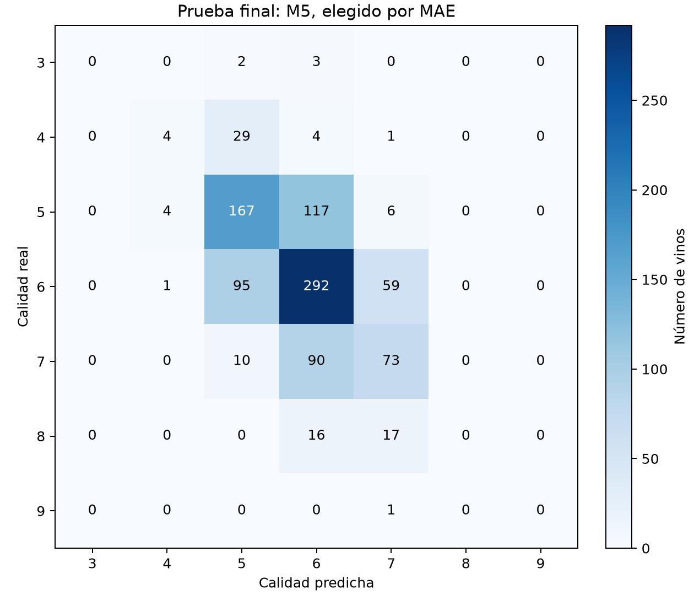
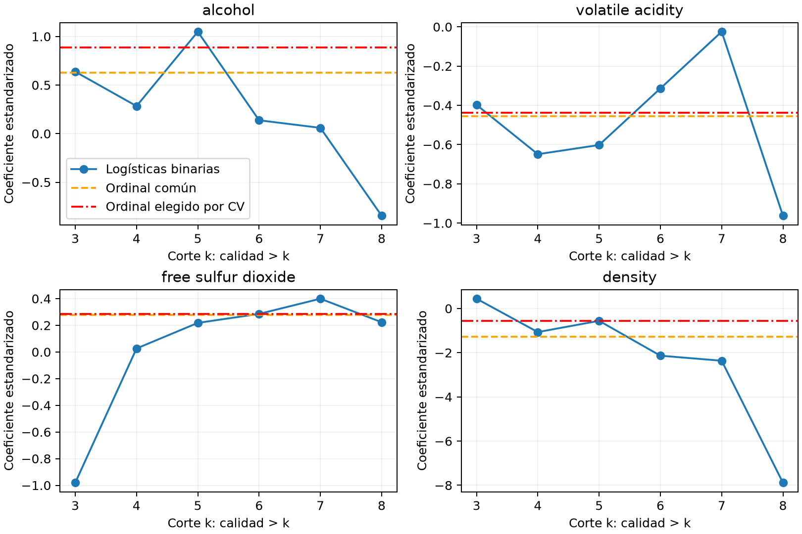
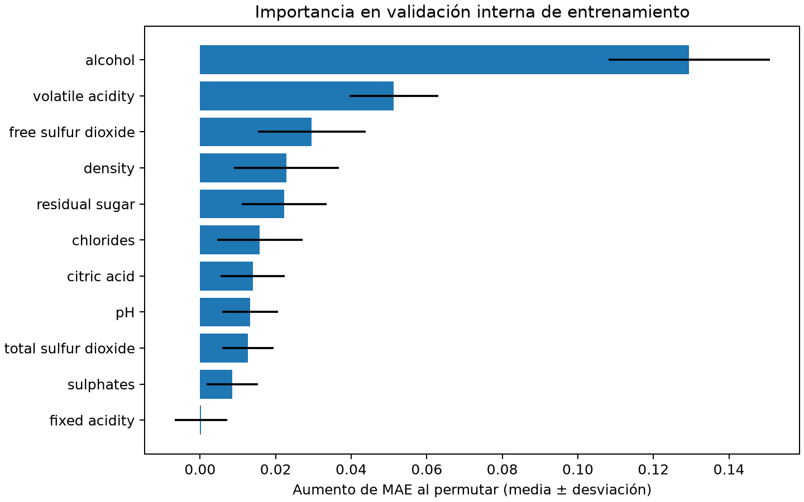

# Problema 2: Regresión ordinal con vino blanco

Parte práctica (a)–(e) ejecutada y revisada por el autor.
Semilla: **221201513**;
a=3, b=1, vino blanco.

## Reproducción

Desde la raíz del repositorio, con Python 3.14.9 y uv:

```sh
uv run --locked python ejecutar.py problema-2
```

El entorno se prepara automáticamente con las versiones de `uv.lock`. La entrada
ejecuta las siete fases en orden, muestra tiempos y se detiene si alguna falla.
También se puede invocar directamente `uv run --locked python problema-2/ejecutar.py todo`.

Si prueba ya está cerrada, se verifican las huellas de modelos, selección y
partición y se regeneran las figuras, sin volver a seleccionar ni evaluar prueba.
El flujo recupera el diagnóstico final tras una interrupción usando solo
entrenamiento. Si detecta una interrupción durante la evaluación de prueba o una
huella alterada, se detiene y conserva los archivos. La reproducción independiente
desde cero se realiza en otra copia limpia. `preparar` también impide sobrescribir
una partición con prueba cerrada.

Los mismos pasos se pueden ejecutar individualmente, en este orden, en una copia
limpia (no es necesario repetirlos después del comando anterior):

```sh
uv run --locked python problema-2/ejecutar.py preparar
uv run --locked python problema-2/ejecutar.py verificar
uv run --locked python problema-2/ejecutar.py seleccionar
uv run --locked python problema-2/ejecutar.py diagnostico
uv run --locked python problema-2/ejecutar.py evaluar
uv run --locked python problema-2/ejecutar.py diagnostico-final
uv run --locked python problema-2/ejecutar.py figuras
```

`evaluar` guarda un marcador local y no vuelve a consultar prueba si ya existe.
Después se bloquean nuevas selecciones y diagnósticos para selección en esa
carpeta. La reproducción completa se realiza en un clon limpio; no se borra el
marcador para seguir ajustando conociendo prueba. El último comando sincroniza
todas las figuras con las tablas finales, incluida la comparación con el ordinal
elegido por CV. Puede repetirse para dibujar desde las tablas, sin reajustar modelos:

```sh
uv run --locked python problema-2/ejecutar.py figuras
```

Pruebas rápidas del modelo y del flujo, sin descargar ni ejecutar experimentos completos:

```sh
uv run --locked --directory problema-2 python -m unittest discover -s tests -v
uv run --locked ruff check .
uv run --locked ruff format --check .
uv run --locked ty check
```

Se limita a un hilo nativo con threadpoolctl. Los imports no descargan ni ajustan.
Las rutas se resuelven desde los archivos. Datos, modelos y predicciones individuales
se conservan en `datos/`, ignorado por Git; `resultados/` contiene salidas agregadas.
No se necesitan las notas locales ni el informe para ejecutar los experimentos.

## (a) Datos y decisiones

[Archivo original de UCI](https://archive.ics.uci.edu/static/public/186/wine+quality.zip).
El código descarga el ZIP y lee winequality-white.csv y winequality.names.
La descripción indica 11 atributos fisicoquímicos y calidad sensorial, mediana de
al menos tres evaluaciones expertas. No hay faltantes. Referencia del origen:
Cortez et al. (2009), _Modeling wine preferences by data mining from physicochemical
properties_, Decision Support Systems 47(4), 547–553,
[DOI](https://doi.org/10.1016/j.dss.2009.05.016).

Se hallaron 937 duplicados exactos entre 4898 filas y ningún perfil de atributos
con etiquetas contradictorias. Se eliminan filas idénticas **antes de dividir**,
conservando la primera aparición: quedan 3961 perfiles únicos. Esto evita copias
idénticas entre entrenamiento, validación y prueba. La alternativa es conservar
la multiplicidad; la elección pierde esa frecuencia y cambia la población evaluada,
sin afirmar que las repeticiones fueran errores del origen.

Se conservan los siete niveles, sin agrupar ni balancear: unir extremos cambiaría
el objetivo y perdería diferencias ordinales. División 75/25 estratificada,
semilla 221201513:

| Calidad | Originales | Sin duplicados | Entrenamiento | Prueba |
| ------: | ---------: | -------------: | ------------: | -----: |
|       3 |         20 |             20 |            15 |      5 |
|       4 |        163 |            153 |           115 |     38 |
|       5 |       1457 |           1175 |           881 |    294 |
|       6 |       2198 |           1788 |          1341 |    447 |
|       7 |        880 |            689 |           516 |    173 |
|       8 |        175 |            131 |            98 |     33 |
|       9 |          5 |              5 |             4 |      1 |
|   Total |       4898 |           3961 |          2970 |    991 |

niveles.csv, particion.csv y datos-metadatos.json registran conteos, índices
originales y SHA256. El CSV original tiene SHA256
`76c3f809815c17c07212622f776311faeb31e87610d52c26d87d6e361b169836`.
La descarga rechaza un CSV con una huella distinta antes de escribirlo.
La prueba se reservó antes de ajustar. Sus conteos solo describen la estratificación.
Todos los modelos usan los once atributos; los cuatro del diagnóstico no se usan
para reentrenar ni seleccionar variables.

## Métrica, costos y protocolo previo a prueba

Escenario: apoyo a revisión humana de calidad. Se elige **MAE**, con costo
`C(y,pred)=abs(y-pred)`: un paso cuesta una unidad y una confusión lejana cuesta
más. Es una decisión de costos, sin afirmar distancias iguales en calidad latente.
Exactitud y QWK son complementarios. QWK pondera cuadráticamente y corrige por azar.
La matriz 7x7 en orden 3..9 está en protocolo.json:

```text
0 1 2 3 4 5 6
1 0 1 2 3 4 5
2 1 0 1 2 3 4
3 2 1 0 1 2 3
4 3 2 1 0 1 2
5 4 3 2 1 0 1
6 5 4 3 2 1 0
```

Se usan tres folds estratificados (990 validaciones por fold), semilla raíz+21.
La clase 9 conserva al menos dos ejemplos en cada entrenamiento. M1, M2 y M3 se
estandarizan dentro de cada fold; no hay imputación necesaria. Boosting usa las
variables originales. No se ajusta ninguna transformación con prueba.
folds.csv y cv.csv permiten auditar 48 ajustes de validación y siete ajustes
finales; cada ajuste M6 incluye seis clasificadores.

## (b) Ordinal propio y verificación

Modelo `P(Y<=k|x)=sigmoid(theta_k-w^T*x)`, sin intercepto redundante.
Se minimiza NLL media + `alpha*||w||²/2`. El gradiente de log-probabilidad en w es
`-(1-sigmoid(a)-sigmoid(b))*x`; la NLL cambia ese signo. Los umbrales tienen
`theta_1=u_1`, `theta_j=u_1+sum(exp(u_l),l=2..j)` y gradiente por regla de cadena.
Para categorías interiores se evita restar probabilidades próximas mediante
`logp=logsigmoid(a)+logsigmoid(-b)+log(-expm1(-(theta_k-theta_{k-1})))`.
Los extremos usan logsigmoid directamente.

Optimizador scipy.optimize.minimize, L-BFGS-B: maxiter=1500, ftol=1e-12,
gtol=1e-7. Los log-incrementos tienen límites de protección [-12,12]; se comprueba
que la frontera no es activa y el máximo gradiente <=1e-4. Pesos y primer umbral
no tienen cotas. Esta protección no restringió los ajustes comparados.

Verificaciones solo en entrenamiento, verificacion-ordinal.json:

- check_grad con paso 1e-6, alpha=0 y 0.1: normas 1.1394e-6 y 1.3319e-6;
  tolerancia 1e-4. Perturbaciones con default_rng(SeedSequence([221201513,2,1])).
- Ajuste propio sin penalizar frente a OrderedModel(logit), mismo escalado y
  sin constante, BFGS independiente: ambos convergen.
- Máxima diferencia de pesos 6.7828e-6 (tolerancia 5e-4), umbrales 3.4213e-5
  (1e-3), probabilidades 4.5079e-6 (1e-4).
- NLL media 1.103338688663 frente a 1.103338688661; 55 iteraciones propias y
  máximo gradiente 1.2008e-6. Tiempo de verificación 2.616 s.

Cuatro pruebas automatizadas: gradientes para K=2,4,7, estabilidad con predictores
extremos, orden, normalización, moda/mediana, redondeo y corrección PAVA.
Otras siete verifican el orden y la detención del flujo, la repetición sin
entrenar ni evaluar prueba, el diagnóstico final recuperable, las huellas, el
cierre interrumpido, la protección de la partición y la versión descargada.

## (c) Comparación y prueba final única

Grillas acotadas por presupuesto, fijadas antes de prueba:

| Modelo               | Candidatos          | Elegido              |  MAE CV |
| -------------------- | ------------------- | -------------------- | ------: |
| M1 lineal            | Sin hiperparámetros | Redondear y recortar | 0.52997 |
| M2 multinomial       | C=0.1,1,10          | C=0.1                | 0.52559 |
| M3 moda              | alpha=0,0.01,0.1    | alpha=0.01           | 0.52963 |
| M3 mediana           | alpha=0,0.01,0.1    | alpha=0.01           | 0.53098 |
| M4 HGB clasificador  | 7 o 15 hojas        | 7 hojas              | 0.50707 |
| M5 HGB regresor      | 7 o 15 hojas        | 15 hojas             | 0.49158 |
| M6 seis HGB binarios | 7 o 15 hojas        | 7 hojas              | 0.48620 |

Boosting: 150 iteraciones, tasa .08, mínimo 20 datos por hoja, L2=1, sin parada
temprana para evitar reservas internas con clases raras. M5 usa pérdida cuadrática.
Las grillas no agotan todos los hiperparámetros: la comparación depende del presupuesto.

M1/M5 convierten con floor(pred+.5) y recorte a 3..9. La alternativa de aprender
cortes dentro de CV añade grados de libertad; se conserva una regla transparente.
M6 estima q_k=P(Y>k), mide violaciones antes de corregir y proyecta cada fila a
probabilidades no crecientes mediante PAVA. Después se obtienen probabilidades
por diferencias y se usa mediana inferior para MAE. PAVA no consulta etiquetas
de evaluación. Restar q crudas podría producir probabilidades negativas; moda
sería la alternativa para exactitud.

| Modelo     |   Exactitud |         MAE |         QWK |
| ---------- | ----------: | ----------: | ----------: |
| M1         |     0.52069 |     0.53986 |     0.40584 |
| M2         |     0.53784 |     0.52472 |     0.42036 |
| M3 moda    |     0.52977 |     0.53280 |     0.39109 |
| M3 mediana |     0.52573 |     0.53582 |     0.39487 |
| M4         | **0.54188** |     0.51362 |     0.49940 |
| M5         |     0.54087 | **0.50757** | **0.51582** |
| M6         |     0.53582 |     0.51362 |     0.49983 |

M5 gana por MAE y QWK; M4 por exactitud, con **un vino más** que M5.
M6, ganador en CV, no gana en prueba. Las diferencias son pequeñas; no se afirma
superioridad estadística ni se reabrió selección. La mediana es óptima para las
probabilidades estimadas, pero no garantiza menor MAE real si están mal especificadas.
M6 tuvo **17/991 = 0.0171544** filas con violaciones antes de PAVA (tolerancia 1e-12).



M5 no predice 3,8,9 en esta prueba. La calidad 9 tiene un solo caso reservado;
no hay una estimación estable de desempeño para ese nivel. La exactitud global
oculta esas limitaciones.

## (d) Momios e importancia por permutación

Antes de prueba se describió M6, elegido por CV. Las importancias usaron cinco
permutaciones por cada uno de los tres folds de entrenamiento. Sus principales
variables: alcohol, acidez volátil, SO2 libre y azúcar residual. Después del ranking
final se añadió un diagnóstico **descriptivo de M5**, mejor boosting de prueba,
con sus hiperparámetros ya fijados y solo datos de entrenamiento. Los modelos
finales conservaron sus SHA256. Los dos diagnósticos se guardan por separado y
no constituyen una nueva selección.

Para M5 se obtuvieron:

| Variable            | Aumento MAE al permutar | w ordinal sin penalizar | w ordinal CV |
| ------------------- | ----------------------: | ----------------------: | -----------: |
| alcohol             |                 0.12949 |                 0.62672 |      0.88708 |
| volatile acidity    |                 0.05125 |                -0.45617 |     -0.43732 |
| free sulfur dioxide |                 0.02956 |                 0.27838 |      0.28343 |
| density             |                 0.02290 |                -1.27864 |     -0.55718 |

Las seis logísticas binarias se ajustaron sin penalizar (C=np.inf) sobre el
mismo escalado de entrenamiento del ordinal sin penalizar. La figura incluye
además el ordinal final con alpha=.01 para distinguir la penalización.



Los coeficientes no son iguales en todos los cortes: alcohol pasa de 1.0494 en
k=5 a -0.8454 en k=8; densidad, de 0.4428 en k=3 a -7.8864 en k=8. Esto cuestiona
una pendiente común exacta, pero no es una prueba formal de rechazo: el último
corte tiene cuatro positivos y el primero quince negativos. Todas las optimizaciones
convergieron; persiste la incertidumbre de las clases escasas.

En el ordinal final, una desviación estándar adicional de alcohol, manteniendo
lo demás fijo, multiplica los momios de superar cualquier corte por
exp(0.887077)=**2.4280**. Es asociación condicional, no causalidad. En el ajuste
sin penalizar el factor es exp(0.626719)=1.8715.



Ambos enfoques destacan alcohol, pero la importancia es cambio predictivo al
permutar, no dirección del efecto. Los coeficientes son asociaciones condicionales
lineales y dependen de correlaciones; boosting puede aprovechar interacciones.
Densidad tiene peso grande sin penalizar e importancia menor que alcohol o acidez
volátil. Las barras son desviación entre permutaciones/folds, no intervalos de
confianza. Son descripciones tras seleccionar hiperparámetros, no estimaciones
finales sin sesgo de selección.

## (e) Recomendación

Para el escenario y MAE elegido se recomienda **M5 con 15 hojas**, redondeado:
MAE 0.50757, mejor QWK y un solo boosting frente a los seis de M6. Su ventaja
frente a M4/M6 equivale a seis unidades totales de error en 991 vinos; no demuestra
superioridad universal. El promedio no asegura buen desempeño en niveles raros.
Los resultados aplican a perfiles únicos, no a la multiplicidad de las 4898 filas.

El ordinal sigue siendo útil por sus 17 parámetros identificables, interpretación
y probabilidades coherentes. Sacrifica flexibilidad al imponer momios proporcionales;
aquí boosting ajusta mejor bajo el criterio elegido. La recomendación se limita
al escenario, los datos y el presupuesto de validación documentados.

## Evidencias, versiones y tiempos

Tablas en resultados/tablas: datos-metadatos.json, niveles.csv, particion.csv,
protocolo.json, folds.csv, verificacion-ordinal.json, cv.csv, seleccion.json,
prueba-metricas.csv, evaluacion-final.json, confusion.csv,
coeficientes-binarios-ordinal.csv y ambas importancias con sus metadatos.
Figuras en resultados/figuras: confusión, densidad latente, coeficientes e importancias;
las variantes -final corresponden a M5. Los datos, modelos y predicciones individuales
permanecen locales e ignorados por Git.

Tiempos: verificación ordinal 2.616 s; CV y ajustes finales portables 39.766 s;
diagnóstico interno M6 70.905 s; diagnóstico final M5 9.044 s. Su primera versión
sin la línea de pesos CV tardó 8.191 s. Se repitió selección solo en entrenamiento
para corregir los nombres de paquete al guardar modelos; las puntuaciones y
configuraciones coincidieron. Cada ejecución completa del protocolo consulta
prueba una sola vez, con los modelos ya fijados; la reproducción independiente
no reabre la selección de hiperparámetros. Versiones: scipy 1.18.1,
pandas 3.1.1, scikit-learn 1.9.1, statsmodels 0.15.0, NumPy 2.5.4, Matplotlib
3.11.2, joblib 1.6.0, threadpoolctl 3.8.0, fijadas en uv.lock.

La revisión integral recorrió las siete fases de reproducción en una copia sin
entorno, descargas, modelos ni resultados previos. Descargó de nuevo el CSV de UCI
con la misma huella SHA-256. Coincidieron las nueve tablas CSV, el contenido
científico de siete JSON (excluyendo tiempos y huellas de archivos que incluyen
tiempos) y las seis figuras byte a byte tras la fase `figuras`. Pasaron las once
pruebas del modelo y del flujo, Ruff, formato y ty. Los modelos congelados
conservaron sus huellas en ambas ejecuciones; no se modificó la selección
original al reproducir el protocolo.

Referencias técnicas consultadas:
[OrderedModel y umbrales](https://www.statsmodels.org/stable/generated/statsmodels.miscmodels.ordinal_model.OrderedModel.transform_threshold_params.html),
[LogisticRegression](https://scikit-learn.org/stable/modules/generated/sklearn.linear_model.LogisticRegression.html).
